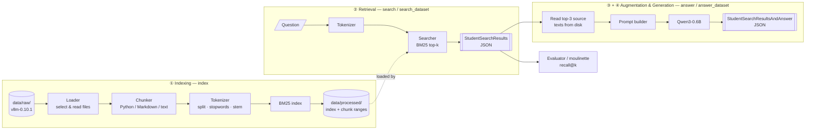
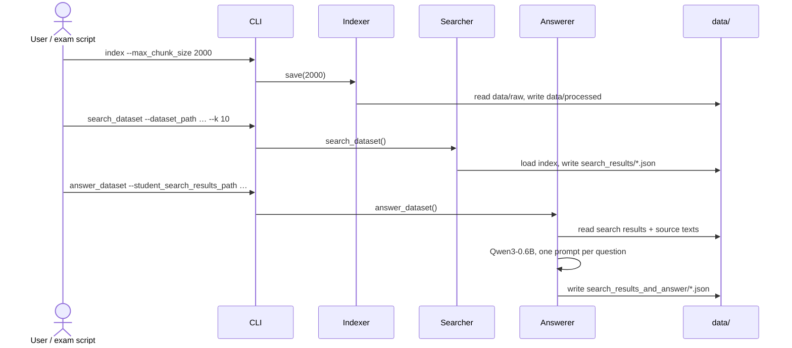
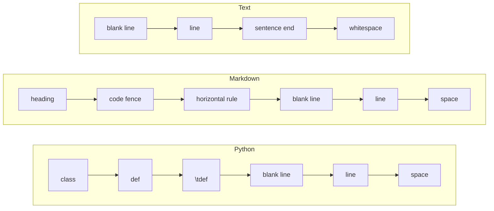
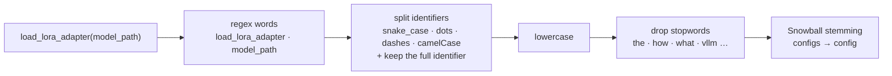

*This project has been created as part of the 42 curriculum by semebrah.*

# RAG against the machine

> A Retrieval-Augmented Generation (RAG) system that answers questions about the
> [vLLM](https://github.com/vllm-project/vllm) codebase: it indexes ~1,100 files
> of code and documentation, retrieves the most relevant snippets with BM25, and
> lets the small local model **Qwen/Qwen3-0.6B** write an answer grounded in them.

| | docs questions | code questions | required |
|---|---|---|---|
| **recall@5** | **0.91** | **0.89** | 0.80 / 0.50 |
| recall@10 | 0.93 | 0.92 | — |
| indexing time | ~25 s for the whole corpus | | ≤ 5 min |
| search time | ~14 s per 100 questions | | ≤ 90 s / 200 |

<sub>Public datasets, k = 10, `max_chunk_size` = 2000, CPU only (Intel i7-8550U, no GPU).</sub>

---

## Table of contents

1. [Description](#description)
2. [Instructions](#instructions)
3. [Example usage](#example-usage)
4. [System architecture](#system-architecture)
5. [Chunking strategy](#chunking-strategy)
6. [Retrieval method](#retrieval-method)
7. [Answer generation](#answer-generation)
8. [Performance analysis](#performance-analysis)
9. [Design decisions](#design-decisions)
10. [Challenges faced](#challenges-faced)
11. [Limitations and future work](#limitations-and-future-work)
12. [Resources](#resources)

---

## Description

A language model only knows what it saw during training. Ask it about a private
codebase and it either refuses or invents something plausible. RAG avoids
retraining: at question time, it **looks up** the relevant parts of an external
source and hands them to the model as context.

This project builds the four RAG stages for the vLLM 0.10.1 repository:

| Stage | What it does here |
|---|---|
| **Indexing** | Reads the Python and Markdown/text files, splits them into chunks of at most 2000 characters, and builds a BM25 index under `data/processed/`. |
| **Retrieving** | Matches a question against the index and returns the top-k chunks as *source locations* (file path + character range). |
| **Augmenting** | Reads the text of the top sources back from disk and places it, labelled, in the model's prompt. |
| **Generating** | Qwen3-0.6B reads that context and writes a short answer grounded in it. |

Retrieval quality is measured with **recall@k**: the share of the reference
sources found in the top-k results, where a result counts when it is in the
same file and overlaps the reference range (IoU ≥ 0.05).

Everything runs on a CPU-only machine, is driven by a [Python Fire](https://github.com/google/python-fire)
CLI, and exchanges data through [pydantic](https://docs.pydantic.dev) models.

---

## Instructions

### Requirements

- Python ≥ 3.10
- [uv](https://docs.astral.sh/uv/) (installed automatically by `make install` if missing)
- ~8 GB of free disk space (~6 GB virtual environment with PyTorch, ~1.5 GB model weights)
- The vLLM 0.10.1 source archive, `vllm-0.10.1.zip`, from the project attachments

### Installation

```bash
git clone <this repository> && cd 42_RAG_against_the_machines
cp /path/to/vllm-0.10.1.zip .     # the corpus is not committed
make install                      # uv sync + extracts the corpus into data/raw/
```

`make install` runs `uv sync` and, if `data/raw/vllm-0.10.1/` is missing,
extracts the archive there with Python's built-in `zipfile` (no `unzip` needed).
The Qwen3-0.6B weights (~1.5 GB) are downloaded from Hugging Face on the first
`answer` command.

### Running the pipeline

The reference pipeline is **index → search_dataset → moulinette → answer_dataset**:

```bash
# 1. Build the index (≈ 25 s)
uv run python -m src index --max_chunk_size 2000

# 2. Search a dataset (≈ 14 s per 100 questions)
uv run python -m src search_dataset \
    --dataset_path data/datasets/UnansweredQuestions/dataset_docs_public.json \
    --k 10 \
    --save_directory data/output/search_results/UnansweredQuestions

# 3. Score it with the provided moulinette
./moulinette evaluate_student_search_results \
    data/output/search_results/UnansweredQuestions/dataset_docs_public.json \
    data/datasets/AnsweredQuestions/dataset_docs_public.json \
    --k 10 --max_context_length 2000

# 4. Generate answers from the saved search results (≈ 15 s per question on CPU)
uv run python -m src answer_dataset \
    --student_search_results_path data/output/search_results/UnansweredQuestions/dataset_docs_public.json \
    --save_directory data/output/search_results_and_answer/UnansweredQuestions
```

Output files keep the name of their input file, so scope `--save_directory` by
dataset (`UnansweredQuestions` / `AnsweredQuestions`) to avoid overwriting.

### Command reference

Every command is run as `uv run python -m src <command> [options]`; all paths are arguments.

| Command | Options | Output |
|---|---|---|
| `index` | `--max_chunk_size` (1–2000, default 2000) | index in `data/processed/` |
| `search <query>` | `--k` | top-k sources, printed |
| `search_dataset` | `--dataset_path`, `--k`, `--save_directory` | `StudentSearchResults` JSON |
| `answer <query>` | `--k` | answer, printed |
| `answer_dataset` | `--student_search_results_path`, `--save_directory` | `StudentSearchResultsAndAnswer` JSON |
| `evaluate` | `--student_search_results_path`, `--dataset_path` | recall@1/3/5/10, printed |

`evaluate` is for my own iterations; the official score comes from the moulinette.

### Makefile

| Target | Action |
|---|---|
| `make install` | install dependencies with uv and extract the corpus |
| `make run` | `index` then `search` on both public datasets |
| `make index` / `make search` / `make evaluate` | individual pipeline steps (results in `_searched/`) |
| `make debug` | run the CLI under `pdb` |
| `make lint` | `flake8 .` and `mypy .` with the flags required by the subject |
| `make lint-strict` | `flake8 .`, `mypy --strict .`, `ruff` and `ty` |
| `make test` | `pytest` |
| `make clean` | remove `__pycache__`, `.mypy_cache`, `.pytest_cache`, … |
| `make fclean` | `clean`, plus the virtual environment and the uv cache (`uv clean`) |

---

## Example usage

**Single search** — each line is a source: `file_path first:last`

```console
$ uv run python -m src search "How do I load a LoRA adapter at runtime?" --k 3
>>> Searching
data/raw/vllm-0.10.1/vllm/plugins/lora_resolvers/README.md 0:829
data/raw/vllm-0.10.1/docs/features/lora.md 6100:8080
data/raw/vllm-0.10.1/docs/features/lora.md 4075:4693
```

**Single answer**

```console
$ uv run python -m src answer "What HTTP endpoint is used to dynamically load a LoRA adapter?" --k 3
>>> Answering
The HTTP endpoint used to dynamically load a LoRA adapter is `/v1/load_lora_adapter`.
```

**Questions with nothing to retrieve** are refused instead of answered from the model's memory:

```console
$ uv run python -m src answer "how" --k 3
>>> Answering
The provided sources do not contain this information.
```

**Self-evaluation**

```console
$ uv run python -m src evaluate \
    --student_search_results_path data/output/search_results/UnansweredQuestions/dataset_docs_public.json \
    --dataset_path data/datasets/AnsweredQuestions/dataset_docs_public.json
>>> Evaluating
recall@1: 0.68
recall@3: 0.87
recall@5: 0.91
recall@10: 0.93
```

**Degenerate input** never produces a traceback:

| Input | Behaviour |
|---|---|
| `search "lora" --k 0` / `--k abc` / `--k 2.5` | `k has to be a valid int type and at least 1.` |
| `search "lora" --k 100000` | returns every chunk (k is capped at the corpus size) |
| `search ""`, `search "how"` | no sources (no searchable words) |
| `index --max_chunk_size 5000` | rejected: must be between 1 and 2000 |
| missing file, malformed JSON | `Error: Couldn't read the input dataset.` |
| Ctrl-C | `Interrupted.` |

---

## System architecture



### Components

| Module | Role |
|---|---|
| `src/__main__.py` | Entry point: runs the Fire CLI and turns any error into a message instead of a traceback. |
| `src/cli.py` | The six commands; validates `k` and `max_chunk_size`. |
| `src/loader.py` | Collects `vllm/**/*.py` plus every `.md` / `.txt` in the repository, skipping `tests`, `build`, `dist`, `.git`, … |
| `src/index/chunker.py` | Splits each file with a strategy matching its type and records exact character offsets. |
| `src/index/tokenizer.py` | Code-aware tokenizer shared by indexing and querying. |
| `src/index/indexer.py` | Prefixes chunks with their path, builds the BM25 index and saves it. |
| `src/searcher.py` | Loads the index, retrieves top-k for one query or a whole dataset (with a `tqdm` progress bar). |
| `src/answer.py` | Builds the prompt from retrieved sources and runs Qwen3-0.6B. |
| `src/evaluator.py` | recall@k with the same IoU rule as the moulinette. |
| `src/models.py` | pydantic models exchanged between the stages (subject models + `Chunk`). |

### Data flow between commands



`answer_dataset` reuses the sources and `question_id`s stored in the search
results file, so answers are generated from exactly the sources the moulinette
scored, and the index is not needed at that point.

---

## Chunking strategy

The corpus is **1,078 files / 14.1 M characters**, cut into **10,123 chunks**
at the default size:

| File type | Files | Chunks | Splitter |
|---|---|---|---|
| Python (`vllm/**/*.py`) | 877 | 9,251 | LangChain `RecursiveCharacterTextSplitter` for Python |
| Markdown (`*.md`) | 178 | 800 | LangChain `RecursiveCharacterTextSplitter` for Markdown |
| Text (`*.txt`, e.g. `CMakeLists.txt`, `requirements/*.txt`) | 23 | 72 | Custom regex separators |

A recursive splitter tries a list of separators **in order**, from the most to
the least meaningful, and only falls back to the next one when a piece is still
longer than `max_chunk_size`. So a chunk ends at the best boundary available:



- **Python** chunks therefore tend to hold whole classes or functions, the unit
  code questions are about ("default value of X in class Y").
- **Markdown** chunks follow the section structure of the documentation.
- **Overlap** is 10 % of the chunk size (200 characters at 2000), so a sentence
  cut at a boundary still appears whole in one of the two chunks.
- **Exact offsets**: each chunk keeps its start index from the splitter, and an
  assertion checks `content[start:end] == chunk`, so `first_character_index` /
  `last_character_index` always point at the right text.
- **Size limit**: `--max_chunk_size` is validated (1–2000), so no source can
  exceed the moulinette's 2000-character `max_context_length`.

---

## Retrieval method

Retrieval is **BM25** (Okapi BM25, Lucene variant, `k1 = 1.5`, `b = 0.75`) via
[bm25q](https://github.com/xhluca/bm25s-quantized), a fast sparse-matrix
implementation compiled with Numba.

### Scoring

For a query $q$ and a chunk $d$:

$$
\text{score}(q, d) = \sum_{t \in q} \text{IDF}(t) \cdot
\frac{f(t, d)\,(k_1 + 1)}{f(t, d) + k_1 \left(1 - b + b \frac{|d|}{\text{avgdl}}\right)}
$$

- **IDF** rewards rare terms: `fused_moe` is a far stronger signal than `model`.
- **Term frequency saturates** (`k1`): repeating a word helps, with diminishing returns.
- **Length normalisation** (`b`): long chunks don't win just by containing more words.

Chunks are ranked by this score, and the top-k are returned as
`MinimalSource(file_path, first_character_index, last_character_index)`.

### What makes it work on code: the tokenizer

Questions and code rarely share exact words, so most of the recall comes from
how text is turned into terms. The same tokenizer runs on chunks and on queries:



1. **Identifier splitting** — `max_num_seqs` becomes `max_num_seqs`, `max`,
   `num`, `seqs`. A question quoting the identifier matches the full token
   (high IDF); a question paraphrasing it matches the parts.
2. **Stopwords** — question words ("what", "how", "does") and "vllm" (in almost
   every question) carry no signal and are removed.
3. **Stemming** (PyStemmer, English Snowball) — "quantized", "quantization" and
   "quantize" share a stem.

### Path boosting

Before tokenizing, each chunk is prefixed with its **path relative to the
repository, repeated twice**:

```text
docs/features/lora.md docs/features/lora.md <chunk text…>
```

File paths summarise their content (`docs/features/quantization/fp8.md`,
`vllm/attention/backends/flashinfer.py`), so path words act as a heavily
weighted title field. This was the largest single gain (see below). Only the
token stream changes: the stored ranges still point at the original text.

---

## Answer generation

| Setting | Value | Why |
|---|---|---|
| Model | `Qwen/Qwen3-0.6B`, thinking mode off | mandatory model; thinking adds latency without better grounding |
| Precision | `float32` on CPU, `auto` on GPU | this CPU has no bf16 support: float32 is ~5× faster |
| Context | top **3** retrieved sources | 3 sources ≈ 1,100 prompt tokens vs ≈ 4,000 for 10 |
| Decoding | greedy, `max_new_tokens = 512` | deterministic and less prone to drift |
| No sources | returns the refusal sentence without calling the model | never answers from memory alone |

The prompt keeps the instructions in the **system message** and puts the
question **after** the context, right before the model starts writing:

```text
[system]
You answer questions about the vLLM codebase using only the provided sources.
Quote names, commands, parameters and values exactly as they appear. Answer
concisely. Include the exact command or code from the sources when the question
asks how to do something. If the question is not about vLLM or software, reply
exactly: "The provided sources do not contain this information."

[user]
--- Source 1: data/raw/vllm-0.10.1/docs/features/lora.md ---
<source text>

--- Source 2: …

Question: <question>
Answer:
```

---

## Performance analysis

### Retrieval (public datasets, k = 10)

| | recall@1 | recall@3 | recall@5 | recall@10 |
|---|---|---|---|---|
| **docs** (100 questions) | 0.68 | 0.87 | **0.91** | 0.93 |
| **code** (99 questions) | 0.59 | 0.81 | **0.89** | 0.92 |

Both are well above the thresholds (docs ≥ 0.80, code ≥ 0.50 at recall@5).
These values were confirmed with the moulinette (`Student data is valid: True`).

### How each step contributed (recall@5)

```text
                                   docs                    code
initial version                    0.76 ███████████████▏   0.69 █████████████▊
remove duplicated docs/ files      0.83 ████████████████▌  0.71 ██████████████▏
+ stopwords + stemming             0.84 ████████████████▊  0.75 ███████████████
+ path prefix (x1)                 0.87 █████████████████▍ 0.85 █████████████████
+ index CMakeLists.txt / .txt      0.90 ██████████████████ 0.85 █████████████████
+ path prefix x2  (final)          0.91 ██████████████████▏0.89 █████████████████▊
```

<sub>Each line adds one change to the line above.</sub>

### Effect of chunk size

Measured with the real CLI (`index --max_chunk_size N`, then `search_dataset --k 10`):

| `max_chunk_size` | chunks | index time | docs R@1 | docs R@5 | docs R@10 | code R@1 | code R@5 | code R@10 |
|---|---|---|---|---|---|---|---|---|
| 500 | 41,539 | 28 s | 0.59 | 0.86 | 0.91 | 0.57 | 0.87 | 0.93 |
| 1000 | 20,616 | 25 s | 0.69 | 0.91 | 0.94 | 0.54 | 0.83 | 0.93 |
| 1500 | 13,456 | 26 s | 0.69 | 0.89 | 0.93 | 0.60 | 0.86 | 0.93 |
| **2000** | **10,123** | **25 s** | 0.68 | **0.91** | 0.93 | 0.59 | **0.89** | 0.92 |

- **recall@10 hardly moves** (0.91–0.94): the right region is found at any size.
- **Small chunks hurt recall@1 and @5 on docs**: at 500 characters a section is
  spread over several chunks, each with fewer matching words, and the reference
  span (median ~1,100 characters) covers several of them.
- **2000 is best overall at recall@5**, and also gives the model the most
  context per source, so it is the default.

### Speed

| Step | Time | Limit |
|---|---|---|
| Indexing (whole corpus) | ~25 s | 5 min |
| `search_dataset`, 100 questions | ~14 s (incl. startup) | 90 s for 200 |
| `answer`, per question | ~13–18 s (CPU) | — |

Answer generation was measured per question on two questions (Intel i7-8550U, 4 threads):

| Configuration | Prompt processing | Total per question |
|---|---|---|
| bfloat16, 10 sources (first version) | 147 s | ~156 s |
| float32, 10 sources | 30 s | ~40 s |
| float32, 5 sources | 12 s | ~22 s |
| **float32, 3 sources (final)** | **6 s** | **~13–16 s** |

The answer length (~55 tokens) was never the bottleneck; reading a long prompt
in an emulated number format was.

### Optimizations applied

**Retrieval** — recall@5 on the public datasets, each row measured on top of the previous one:

| # | Optimization | Where | docs | code |
|---|---|---|---|---|
| 0 | Initial version: recursive splitters, identifier-splitting tokenizer, BM25 | — | 0.76 | 0.69 |
| 1 | Index each directory once (`docs/` was collected twice, 690 duplicate chunks) | `loader.py` → `DIRS` | 0.83 | 0.71 |
| 2 | Drop stopwords (question words and "vllm") | `tokenizer.py` → `STOPWORDS` | | |
| 3 | English Snowball stemming (PyStemmer) | `tokenizer.py` → `Tokenizer.tokenize` | 0.84 | 0.75 |
| 4 | Prefix each chunk with its file path before tokenizing | `indexer.py` → `Indexer.save` | 0.87 | 0.85 |
| 5 | Index `.txt` files (`CMakeLists.txt`, `requirements/*.txt`) | `loader.py` → `DIRS` | 0.90 | 0.85 |
| 6 | Repeat the path prefix twice | `indexer.py` → `PATH_WEIGHT = 2` | **0.91** | **0.89** |
| 7 | Keep `max_chunk_size = 2000` (best of 500–2000, see above) | `cli.py` → `index` | 0.91 | 0.89 |

<sub>Rows 2 and 3 were measured together.</sub>

Tried and not kept, because they gave no gain or cost too much: other BM25
parameters (`k1` 0.9–2.0, `b` 0.5/0.9, BM25+), 0 % or 25 % chunk overlap, path
prefix ×3, and hybrid BM25 + embeddings (too slow to index).

**Generation** — measured on the same questions, Intel i7-8550U, CPU only:

| # | Optimization | Where | Effect |
|---|---|---|---|
| 1 | Load the model in `float32` on CPU instead of the config's `bfloat16` (this CPU emulates bf16) | `answer.py` → `Answerer.__init__` | prompt processing 147 s → 30 s per question (10 sources) |
| 2 | Pass only the top 3 sources to the model | `answer.py` → `TOP_SOURCES_COUNT = 3` | prompt ≈ 4,000 → 1,100 tokens; 30 s → 6 s |
| 3 | `answer_dataset` answers from the sources stored in the search results instead of searching again | `answer.py` → `Answerer.answer_dataset` | no index load or search per question; answers match the scored sources |
| 4 | Labelled `--- Source N: path ---` blocks instead of a Python list of strings, question placed last | `answer.py` → `Answerer.build_prompt` | readable context with intact newlines and code indentation |
| 5 | Refusal rule in the system prompt, by topic, instead of an exact sentence next to the question | `answer.py` → `SYSTEM_PROMPT` | answerable questions answered: 1/9 → 6/9 (the other 3 had no answer in their sources) |
| 6 | Greedy decoding (`do_sample=False`) | `answer.py` → `Answerer.generate` | same answer on every run |
| 7 | Return the refusal sentence directly when nothing was retrieved | `answer.py` → `Answerer.generate` | no ungrounded answer, no model call |

Together, rows 1 and 2 bring an answer from **~156 s to ~13 s** (about 12× faster).

---

## Design decisions

| Decision | Alternatives considered | Reason |
|---|---|---|
| **BM25** over TF-IDF | TF-IDF | saturating term frequency and length normalisation suit chunks of varying size |
| **bm25q** library | hand-written BM25 | sparse-matrix scoring is fast enough to search 200 questions in seconds |
| **LangChain recursive splitters** | fixed-size windows, AST parsing | respect class/def and heading boundaries with exact offsets, two strategies with one API |
| **Code-aware tokenizer** (identifier splitting + full token) | plain whitespace split | questions both quote identifiers verbatim and paraphrase them |
| **Path prefix ×2** | separate title field | one line of code, biggest recall gain; ×3 gave nothing more |
| **Index `.md` and `.txt` everywhere, `.py` only in `vllm/`** | only `docs/` | some docs answers live in `CMakeLists.txt` or root files like `RELEASE.md` |
| **Default chunk size 2000** | 500–1500 | best recall@5 (see table) and most context per source |
| **Top-3 sources for generation** | all k | 3× faster answers; recall@3 → @10 adds few hits |
| **Refusal rule in the system prompt** | exact refusal sentence in the user message | the 0.6B model copied the sentence as a template and refused 8/9 answerable questions |
| **Answers reuse saved sources** | search again per question | the answers match the sources that were scored |

---

## Challenges faced

| Problem | How it showed | Solution |
|---|---|---|
| **Duplicated documentation** | `docs/` listed both on its own and under the repository root, so 690 chunks were indexed twice and filled top-k slots | index each directory once → docs recall@5 0.76 → 0.83 |
| **Vocabulary mismatch** between questions and code | "how is the batch size limited" vs `max_num_seqs` | identifier splitting, stopwords, stemming, path boosting |
| **Answers outside the indexed files** | 3 docs answers were in `CMakeLists.txt` | index `.txt` files too |
| **`--max_chunk_size` ignored** | the chunker was always built with its default size | pass the size to the `Chunker` constructor; validate 1–2000 |
| **Very slow answers** (~156 s/question) | bfloat16 is emulated on this CPU | float32 on CPU, top-3 sources → ~13 s/question |
| **Over-refusal** | an exact refusal sentence next to the question made the model refuse almost everything | moved the rule to the system prompt, phrased by topic; compared variants on answerable and off-topic questions |
| **Answer contained the prompt** | an off-by-one-style slice (`slice(n)` = `[:n]`) decoded the prompt instead of the new tokens | `slice(n, None)` |
| **Semantic embeddings too slow** | embedding all chunks with MiniLM took 524 s on CPU | kept pure BM25 (see below) |

---

## Limitations and future work

- **Paraphrased questions** with no word in common with the source remain the
  main source of misses. A hybrid BM25 + `all-MiniLM-L6-v2` ranking was tested:
  it helped some docs questions slightly but embedding the corpus took ~9 minutes on
  this CPU, beyond the 5-minute indexing limit, so it was not adopted.
- **Right file, wrong chunk**: for code questions the correct file is often
  found but a neighbouring chunk ranks higher.
- **The small model** sometimes answers general-knowledge questions from memory
  ("What is the capital of France?") despite the instruction; empty retrievals
  are refused in code, not by the model.
- The index is reloaded for each query; caching it in memory would speed up
  `search_dataset` further.
- None of the bonus features (embeddings, hybrid retrieval, incremental
  indexing, caching, HTTP API) is implemented.

---

## Resources

### Documentation

- [bm25q / bm25s-quantized](https://github.com/xhluca/bm25s-quantized)
- [LangChain text splitters](https://python.langchain.com/docs/concepts/text_splitters/)
- [Hugging Face Transformers](https://huggingface.co/docs/transformers)
- [Python Fire](https://github.com/google/python-fire) · [pydantic](https://docs.pydantic.dev) · [tqdm](https://tqdm.github.io/) · [uv](https://docs.astral.sh/uv/)
- [vLLM repository](https://github.com/vllm-project/vllm) (the indexed corpus, v0.10.1)

### How AI was used

AI (Claude, through Claude Code) was used as a reviewing and experimentation
assistant. The pipeline itself (loader, chunker, tokenizer, indexer, searcher,
answerer, evaluator, CLI) was written by me; every AI-suggested change was
reviewed, tested and only kept when I could explain it.

| Task | Part of the project |
|---|---|
| Writing throwaway experiment scripts to compare retrieval variants (stopwords, stemming, path boosting, chunk size, BM25 parameters, hybrid embeddings) | retrieval tuning |
| Benchmarking answer generation (precision, number of sources) and comparing prompt variants | `src/answer.py` |
| Drafting docstrings and this README | documentation |
